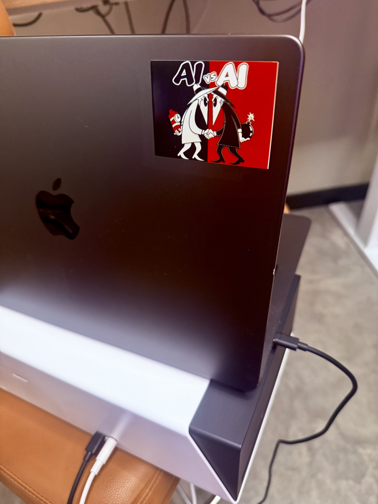

# PixCut S1 — Mac CLI

Print and cut stickers from your Mac over USB. Drop artwork into `create/`,
preview a sheet, choose how many sheets to print, and confirm. Images are
processed locally, with no cloud account required.

| Artwork | Finished sticker |
| --- | --- |
|  |  |

This design is approximately **65 × 48.7 mm**, with no added border.
Three fit on one sheet.

## Quick start

Requires macOS, [Homebrew](https://brew.sh), a USB data cable, and
**Liene 4×7 sticker paper**.

```sh
git clone https://github.com/gregcmartin/pixcut-s1-mac.git
cd pixcut-s1-mac
./setup.sh
```

Install the ribbon and cutting blade, load the paper cassette, and keep the
front and rear paper paths clear. Power on the printer and connect it by USB.
Close the Liene app if it is using the connection.

```sh
./pixcut doctor
./pixcut watch
```

Add an image to `create/`. The watcher prepares a sheet and shows a terminal
preview. Choose a sheet count, then type `PRINT 1` (or the chosen count) to
print. The confirmation also shows the total number of stickers.
Enter at the final prompt skips the job; Ctrl-C stops the watcher.

## Artwork and layout

The default fills each sheet with copies **65 mm wide**, with **no added
border**, 5 mm minimum margins, and 3 mm gaps. Height follows the image's aspect
ratio. Artwork is not shrunk or rotated to fit more copies.

PNG, JPEG, WebP, HEIC/HEIF, TIFF, and BMP are supported. Use a transparent PNG
for shaped stickers; opaque images get a rectangular cut. Separate artwork
islands produce separate cuts, and interior holes are not cut.

```sh
# Prepare a sheet without printing.
./pixcut prepare create/my-sticker.png --width-mm 65 --border-mm 0

# Use the JOB_ID returned by prepare.
./pixcut preview JOB_ID --terminal
./pixcut print JOB_ID

# Print two sheets of a prepared design.
./pixcut print JOB_ID --copies 2

# Change the watcher defaults.
./pixcut watch --width-mm 50 --border-mm 2

# Place only one sticker on each sheet.
./pixcut prepare create/my-sticker.png --repeat 1
```

Use `--repeat auto` to fill the sheet or `--repeat N` for a fixed count.
Counts that do not fit are rejected. Plan to use a full sheet for each print;
partial-sheet refeeding is not supported.

For a plain white background, try `--background white` and inspect the preview.
It removes near-white areas connected to the image edges, so it can also remove
white artwork that touches the background. For complex backgrounds, prepare
a transparent PNG first.

The full preview is saved as `jobs/JOB_ID/preview.png`. Red outlines show the
cut paths and are not printed.

## Cut pressure

The cutter makes a **kiss cut**: the sticker should peel away while the backing
stays intact. To compare cut pressures on one sheet:

```sh
./pixcut calibrate-pressure create/my-sticker.png
./pixcut preview JOB_ID --terminal
./pixcut print JOB_ID
```

At the default size, pressures are **42, 44, and 46**, from top to bottom.
Use the lowest value that peels cleanly with `--knife-pressure VALUE` when
preparing a sheet or starting the watcher. The comparison does not change
your defaults.

## Printer controls and troubleshooting

```sh
./pixcut status
./pixcut jobs
./pixcut cancel
./pixcut resume
./pixcut history
./pixcut --help
```

Controls can run in another terminal during a print. If the printer is not
found, check power and the USB data cable. A charge-only cable will not work.
The print prompt asks you to confirm that white 4×7 sticker paper is loaded.

A disconnected or interrupted job is never automatically resent. If history
shows `needs-review` or `in-progress`, inspect the printer and run `./pixcut jobs`
before retrying. Reprint an existing sheet with `./pixcut print JOB_ID`; prepare
a new job to change its size, layout, or cut pressure.

## Project details

Original images stay in `create/`; prepared sheets and print history are kept
in `jobs/`. These folders are excluded from Git. See [SECURITY.md](SECURITY.md)
for local data and bug-report guidance.

Setup installs libusb, a local Python 3.12 environment, and the pinned
[PixCut-App](https://github.com/popcornhax/PixCut-App) driver.
See [UPSTREAM.md](UPSTREAM.md) and [THIRD_PARTY_NOTICES.md](THIRD_PARTY_NOTICES.md)
for attribution. This is an independent project, unaffiliated with Liene.

Licensed under [MIT](LICENSE).
